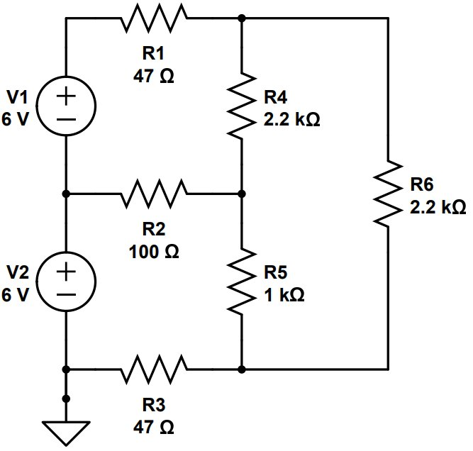
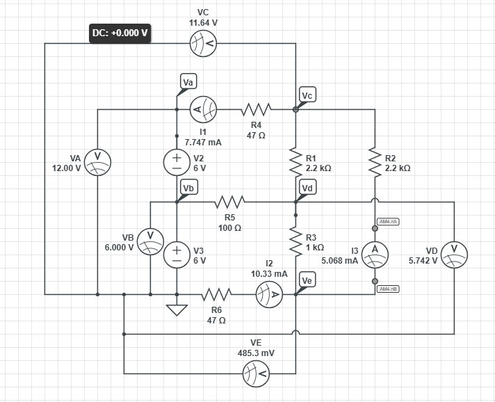

# Mesh and Nodal Analysis of a Two-Source DC Network
**ECE 263 Linear Circuit Theory I · Lab 6 · Valparaiso University · Fall 2026**  
Lab partner: Lesley Osorio

> **Key result:** Hand analysis and CircuitLab agreed within 0.05%

Solved a two-source, six-resistor DC network three ways: by hand, in simulation, and on the bench.

## What I did

- Hand mesh analysis and CircuitLab agreed within 0.05% on every node voltage and mesh current.
- The breadboard read 0.6% to 2.9% high; re-solving with the measured source voltages and resistances brought every value within 0.72%.
- Confirmed the power balance: the sources delivered 108.4 mW in theory and 111.4 mW on the bench, all absorbed by the resistors.

## Report
- 📄 [Full report (PDF)](Guerrero_ECE263_Lab6_Mesh_and_Nodal_Analysis.pdf)

## Figures

### Schematic: Two-source, six-resistor DC network

### Schematic: CircuitLab simulation with meters on every node and mesh

## Tools
Mesh analysis, CircuitLab, DMM, bench power supplies

---

**Austin Guerrero** · Electrical Engineering, Valparaiso University (Christ Honors College)  
Portfolio: [austinguerrero.dev](https://austinguerrero.dev) · LinkedIn: [in/guerrero-austin](https://www.linkedin.com/in/guerrero-austin)
